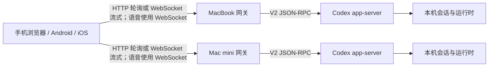

# Codex Mobile

[](https://www.npmjs.com/package/codex-mobile)
[](https://github.com/loock-ai/codex-mobile/releases/latest)
[](LICENSE)


**在手机上查看、继续和管理运行在 Mac 上的真实 Codex 工作流。**

Codex Mobile 是一个移动优先的 Codex Remote 客户端。它通过轻量网关直接连接官方
Codex `app-server` V2，复用真实会话、项目、工具调用和审批，并可在一个客户端中
同时管理多台 Mac。

[快速开始](#快速开始) · [核心能力](#核心能力) · [系统架构](#系统架构) ·
[移动端构建](#移动端构建) · [已知边界](#已知边界) · [文档索引](docs/README.md)

> Codex Mobile 是独立开源项目，与 OpenAI 官方没有隶属关系。

## 界面预览

| 会话列表 | 对话详情 | 设备设置 |
| --- | --- | --- |
|  |  |  |

## 快速开始

### 1. 安装网关

要求 Node.js 20.9 或更高版本，并确保本机已有可用的 `codex` CLI。

```bash
npm install -g codex-mobile
```

只在当前电脑访问：

```bash
codex-mobile start
```

默认打开 [http://127.0.0.1:18766](http://127.0.0.1:18766)。

### 2. 允许手机通过局域网连接

非回环监听必须配置访问口令：

```bash
HOST=0.0.0.0 \
CODEX_MOBILE_TOKEN='<随机口令>' \
codex-mobile start
```

在另一个终端显示连接地址和二维码：

```bash
codex-mobile auth
```

手机扫码后即可打开：

```text
http://<电脑局域网IP>:18766/?token=<随机口令>
```

纯文本脚本可使用 `codex-mobile auth --plain`。最近一次成功启动的实际端口和访问口令
保存在 `~/.codex-mobile/runtime.json`，文件权限为 `0600`。

### 3. 添加更多设备

在另一台 Mac 上用不同口令启动网关，然后在 Codex Mobile 的设备管理中输入其完整
地址。客户端通过 `/api/host` 检查设备状态，使用当前选择的传输方式验证上游后保存
设备；HTTP 模式还会检查网关的轮询能力。

客户端不设置设备数量上限，可同时维持所有已启用设备的连接；保存和恢复完整设备列表及排序。

现役双端客户端为0.3.29（3029）：修复 iOS 普通文件选择后点击“打开”无响应，改为系统复制导入；恢复自由选文的系统默认选区和手柄颜色；附件与输入文字左端对齐；支持手机关注与桌面置顶双向同步。2026-10-22成功批次及独立渠道回验已完成，见[发布计划](docs/superpowers/plans/2026-10-22-file-picker-copy-release.md)与[公共凭证](docs/superpowers/plans/evidence/2026-10-22-file-picker-copy-release.json)。本次未部署网关，桌面置顶的网关独立通知变更尚未上线；新版真机原生文件入口、覆盖安装和数据保留仍待现场验收。

对话“置顶／取消置顶”文案与 iOS 置顶对话前的 SF Symbol `pin.fill` 已验证，尚未发布；现役0.3.29仍使用旧“关注”文案。[截图与验收状态](docs/interaction-alignment.md#2026-10-23-对话置顶文案与图标)。

此前0.3.27已发布：iOS视频画面和文件信息行像图片一样打开独立预览页；移除聊天视频下方的独立播放按钮及留白；修复侧栏顶部整排裁切，列表可从透明悬浮按钮间隙下方滚过；已展开项目刷新时保留原列表，不再重复收起展开。[发布与验收记录](docs/superpowers/plans/evidence/2026-10-21-video-preview-release.json)。

## 为什么做这个项目

Codex Desktop 很适合坐在电脑前完成开发任务，但长任务启动后，用户仍可能需要在
手机上：

- 查看进行状态和最终结果；
- 处理命令、文件修改和补充信息审批；
- 继续已有会话或快速发起新任务；
- 在 MacBook、Mac mini 等多台开发机器之间切换。

本项目不是把终端页面缩小后塞进 WebView，也不维护一套模拟 Codex 的聊天协议。
前端针对手机重新设计，业务数据仍来自真实的 Codex `app-server`。

## 核心能力

| 能力 | 说明 |
| --- | --- |
| 多设备 | 添加、测试、启停和切换多个网关；汇总各机器的连接与待审批状态 |
| 会话组织 | 全部机器时间流、单机项目分组、搜索、折叠、置顶、未读、重命名和归档 |
| 长会话 | 即时进入详情、骨架屏、错误重试、turns 分页和滚动位置保持 |
| 执行状态 | HTTP 拉取消息、reasoning、工具调用、执行计划和文件变更；可停止运行中的 turn |
| 模型与权限 | 从 app-server 读取模型、推理强度、服务档位、权限和审批策略 |
| Skill 调用 | 输入 `@` 搜索当前项目已安装的 Skill，选择后随消息直接调用 |
| 审批 | 支持命令、文件修改、附加权限和 `requestUserInput` |
| Sidechat | 从主聊天最近结束回合创建临时全屏分支；支持多分支与并行运行，返回保留、确认关闭或空闲24小时清理，文件目录共享；引导与历史编辑修复已发布0.3.23 |
| 选文引用与提问 | 长按文字后加入当前输入，或带引用进入 Sidechat；支持多条引用、展开移除与主/分支输入保留；自由选文系统默认颜色修复已发布0.3.29，待人工验收 |
| 新对话草稿 | 手动保存多条本地草稿；从侧栏刷新左侧“草稿”入口恢复文字、图片、文件、设备、项目及发送配置 |
| 文件与媒体 | Markdown/GFM、Mermaid 图表及源码查看/复制、照片、视频与文件输入、当前位置、远程图片、远程文本、Markdown/HTML 预览和文件 Diff |
| 前后台恢复 | 后台暂停轮询，回到前台或网络恢复时立即同步；离线保留内容并显示同步状态 |
| 多端复用 | 同一套前端运行于 Web、Android 和 iOS，不在 App 中固化后端地址 |

桌面会话中的文件引用和明确的附件列表会显示为可点击的文件名，支持中文、空格及括号等名称。点击后使用对应设备的现有文件预览或下载入口；Word、Excel 等二进制文件提供下载。代码示例中的引用保留原样，复制保留原始消息。新消息兼容实现将附件和选文引用与正文分开展示，并使用桌面兼容格式发送；编辑只修改问题并保留附件与引用，HEIC导入时转JPEG且不保留原件。该改动已通过iPhone 17 Pro模拟器验证及用户验收，并合入main；尚未发布，不迁移旧消息。

### Sidechat

主聊天更多菜单可创建或切换 Sidechat。分支继承上下文及执行环境，只显示新增消息；默认只读探索，修改需要在分支中明确提出，并禁用子代理。顶部返回主聊天会保留分支，关闭先二次确认，确认后才停止执行并清理；取消保留聊天、执行状态、队列与草稿。**文件目录与主聊天共享，获准修改会影响同一目录。**

引导与历史编辑修复已随0.3.23发布：运行中的待发消息可改为引导；空闲且无队列时可在原位置编辑已发送消息，有后续内容时先确认删除。编辑通过重建临时分支保留此前上下文、引用和附件，受理成功后替换原分支，失败保留原分支与编辑内容。具体状态见[交互约定](docs/interaction-alignment.md)。

网关仅在内存中保留新增消息以支持 App 重连；本地关联记录仅含 ID 和时间。空闲24小时过期，执行中暂停计时；daemon 重启后可能失效，不自动重建。源码与模拟器流程已验证并按用户要求合入main；客户端未发布，生产网关未部署，当前验收继续使用临时测试网关。

### 新对话草稿

在非原生新对话输入区点击“保存草稿”，原生界面从新对话菜单保存。可以同时保留正文、已选择的图片和文件，以及机器、项目、模型、推理强度、服务档位、权限与审批配置。仅有附件也能保存，保存不创建远程会话、不上传附件。

非原生界面从边栏刷新按钮左侧进入“草稿”，原生界面从侧栏底部省略号菜单进入。草稿箱显示所有设备的本地草稿。点击任意记录直接回到新对话界面，恢复后再保存会更新该记录；可以单条删除。首条消息确认发送成功后移除对应草稿，失败或发送结果待确认时继续保留。

草稿保存在当前浏览器或 App 的 IndexedDB，不跨设备同步。文件保留完整二进制内容，关闭和重启客户端后仍可恢复；清除客户端数据会同时删除草稿。停用的目标设备恢复草稿时会启用；已移除的设备无法直接恢复，草稿仍保留供查看或删除。

### 移动端交互

iOS AgentApp 完整原生界面的最新交互、验收要点和覆盖关系统一见[交互与功能约定](docs/interaction-alignment.md)，后续功能与交互修改在该文档持续记录。

- 会话列表以侧边栏组织，标题与机器切换栏联合吸顶。
- “全部”视图按时间汇总多台机器；单机视图按本机项目目录分组。
- 从当前对话发起新对话时自动选择同一机器与项目；无项目会话继续选择无项目。显式指定机器、项目或恢复草稿时沿用对应目标。
- 项目目录先展示，会话并发加载、独立渲染和独立重试。
- 首屏只加载最近 5 个 turns，每次继续读取 5 个旧回合；非原生界面沿用滚动到顶部加载，AgentApp 原生界面首次到顶不加载，松手后下一次独立下拉才加载，并保持阅读位置。
- 会话列表长按使用 iOS/Android 系统菜单；用户消息长按可编辑或复制完整正文，忙碌时仍可复制。浏览器保留网页菜单。
- 网页和 iOS 原生界面的历史消息都在原消息位置编辑并保存重发，有后续对话时需确认删除后续；原消息附件保留。原生编辑时自动聚焦并弹出键盘；用户消息完整显示且不再折叠，回到底部使用约0.55秒的easeIn动画。所有归档均通过系统小弹窗二次确认，取消保留原会话与排队消息。
- 工具、审批、文件、Diff 和状态信息使用适合触控的底部 Sheet 展示。
- 运行状态显示在具体会话上，项目折叠时在名称后聚合显示运行/未读标记；机器连接状态仍独立显示。
- iOS 原生回答在执行过程入口显示整轮用时，例如“用时1小时2分钟3秒”；无可靠计时数据时显示“执行过程”并保留展开。回答末尾只显示完成时间。
- 过程图片按消息顺序显示在对应 commentary 下方，随历史过程展开；每条 commentary 的时间放在所属图片之后，无图时放在正文之后，显示本地时区的日期和分钟。时间由网关只读原始会话记录并按消息 ID 匹配，缺少匹配记录时不显示推测时间。

### 界面模式

保留非原生界面与 iOS 完整原生界面两套实现。Web、Android 和未开启原生界面的 iOS 使用当前非原生界面，输入区使用网页输入框。

新版 Web 界面与网页搭配原生输入框的模式已移除，对应开关不再显示。升级保留“使用原生界面”的现有选择；旧新版 Web 与独立原生输入框偏好不再生效。iOS 首次安装默认使用原生界面和黑色强调色，已有明确保存的界面和颜色选择继续保留。

### iOS 原生界面（默认）

iOS 18 及以上默认使用原生界面，呈现层采用 AgentApp 的 SwiftUI 页面、主题与交互：侧栏宽度为屏幕的 4/5，右上角提供与底部更多按钮对齐的刷新按钮，底部搜索和省略号菜单管理搜索、设备范围、草稿、刷新和设置，悬浮 Chat 按钮开始新对话；输入栏支持模型、思考强度、速度、权限与附件。附件加号直接打开系统菜单，照片、视频和文件选择后自动加入输入区，位置点选即请求授权；表格长内容支持自动换行。设备、项目、会话、审批、队列和文件等数据及操作仍复用既有真实业务，不加载原型示例。首次打开默认原生界面，可在设置中改用网页界面。

- 非原生界面：会话列表右上角“管理设备” → “使用原生界面”。
- 原生界面：侧栏 → 底部省略号菜单 → “设置” → “原生界面”。

“使用原生界面”是唯一的界面开关，在下次**完整启动 App**时生效，普通切到后台再回来不会更换界面。普通浏览器与 Android 不显示此 iOS 开关。完整原生界面继续使用原生输入框和原生菜单。

切换前先在本机保存未发送文字、图片和文件，以及设备、项目、会话与发送配置；保存失败保持原偏好并显示错误。恢复不会自动发送，也不会把检查点加入手动草稿列表。

侧栏底部省略号菜单可切换设备、打开草稿、刷新和设置；设备管理从设置进入，搜索按钮独立显示。项目行点击展开或收起，每次“加载更多”读取后端下一批；置顶会话沿用真实列表；新添加设备的项目分组默认全部折叠；普通项目和无项目分组点击展开才读取五条计数会话，折叠时不预取，运行会话计入五条，加载更多再增加五条，空闲未读沿用独立摘要。输入框聚焦后展开附件、权限及模型控制，模型与思考强度分别通过独立原生菜单选择，档位来自当前模型真实能力，闪电直接切换普通/Fast。加号打开照片与文件选择页，导入失败保留待添加内容；仅有附件也可发送。设备扫码、位置、队列、历史编辑和审批均调用真实业务。

原生对话右上角的 SF circle 打开“用量与额度”，显示上下文余量、七天额度剩余、距七天窗口重置的刷新时间、累计输入 Token（有有效数据时附缓存命中率）和输出 Token。非原生界面保留现有用量卡片。输入与输出以 K/M 缩写，缺失或无效数据显示“暂无数据”；原生口径与刷新时间格式见[交互约定](docs/interaction-alignment.md#43-用量与额度)。切换或隐藏会话会关闭卡片。原生设置保留语言、设备、传输、通知、外观和强调色，版本行仅展示已安装版本。

iOS 网页会话菜单与侧栏的“重命名”显示系统文本输入框，预填当前名称；取消不更名，保存沿用现有会话名称更新。完整原生界面保留相同的重命名能力。

原生界面和旧界面共用已有业务与数据。原生加载错误时，可选择“使用旧界面恢复”继续使用同一份当前状态。原生界面使用 AgentApp 的字号与系统 Dynamic Type，支持深浅色、强调色和既有语言设置；不新增语音入口。实现边界见 [原生界面桥接说明](docs/native-ui-business-bridge.md)。

## 系统架构



每台 Mac 运行自己的网关和 app-server，设备之间不互相代理。网关负责：

- 提供静态前端，也可关闭静态资源进入 gateway-only 模式；
- 校验局域网访问口令；
- 提供 `/api/host`、`/api/status` 和 `/api/projects` 控制面；
- 为 HTTP 客户端持有回环地址上的 app-server 会话连接，缓存有界执行状态和待审批；
- 对写请求持久去重，并提供 `/api/rpc`、`/api/events` 和 `/api/operations`；
- 通过 `/api/follow-ups` 持久保存排队消息，使用独立后台会话按会话顺序接续发送；
- HTTP 模式的实时语音通过按需 `/api/realtime` WebSocket 共享同一会话；流式模式使用 `/ws` 传输文字与语音；
- 在 Managed 模式下启动和管理 app-server 生命周期。

会话历史仍以 app-server 为准，网关不建立第二套历史数据库。写操作记录保存在
`$CODEX_HOME/codex-mobile-http`（默认 `~/.codex/codex-mobile-http`），用于防止弱网
重试重复执行；网关重启后，无法确认的操作不会自动重放。遇到“请求结果待确认”时先检查
会话，相同内容重试沿用原操作 ID，勿修改内容后反复发送。

排队消息在网关确认后保存到 `$CODEX_HOME/codex-mobile-follow-ups/queue.json`。手机退出、断线或切换会话后，网关仍会等待当前回合结束并按顺序发送；网关重启会核对原请求记录再恢复。正文、附件、提及与发送设置在入队时一起冻结，客户端重新连接后读取同一队列。HTTP 和流式模式共用这套队列，设备网关须升级到支持 `followUpQueue` 的版本。

发送失败或结果待确认时，当前会话的后续排队暂停。明确失败可以编辑、重试或取消；结果待确认只能核对会话后显式移除记录，移除不会撤销已发送的任务。普通直接发送失败时的手动重试草稿仍暂存于当前客户端；尚未获得网关入队确认的草稿也应保留到提交结果确认后。

在“管理设备 → 传输方式”中选择 **HTTP** 或 **流式**，默认 HTTP。选择保存在当前客户端，
应用于所有设备；切换后自动重连并恢复当前会话。流式模式通过 `/ws` 即时接收回复、
推理和工具输出增量。

HTTP 模式下，文字交互不需要手机常驻 WebSocket：前台执行中每 3 秒拉取，空闲每 15 秒拉取；网络失败
退避至最长 30 秒，回前台或网络恢复立即同步。

重新打开或重连会话、回前台及事件游标重置时，后台补齐当前仍在运行且尚无最终答复的回合 commentary，按消息 ID 合并并保留已到达的实时文本。常规轮询不重复触发这项回填。网关只返回当前回合的过程文字及用户插话文字，不返回工具输出、diff 或附件；网关与 app-server 之间仍需读取当前单回合完整记录。旧网关不支持该接口时继续显示摘要和实时消息。

执行中会话正文仅展示助手的过程说明（`commentary`）；收到 `final_answer` 后立即展示最终答复，
过程说明（`commentary`）默认收入可展开的历史过程区，展开条数仅统计过程说明，不等待整个回合结束。
已完成回合的 commentary 复用统计/图片详情回填，重新打开、刷新及历史分页后恢复展开入口；网关只额外返回过程文字和消息 ID 顺序，不下发工具正文，也不重复传用户或最终答复正文。
展开区只显示 commentary，相邻 commentary 之间使用浅灰色分隔线；reasoning、工具执行、文件修改和原生过程媒体不进入展开区。
用户引导消息保留，每段回复独立切换；旧协议无 phase 的助手消息保留兼容显示。
页面保留等待审批及最近同步状态，不估算进度百分比。完成通知与完成未读状态只在明确标记为 final answer 的
回复完成后产生；后台暂停时会在恢复同步后产生，启动或重连的
首轮历史同步不会补发旧通知或重设未读。HTTP 模式要求网关支持 `httpPolling`，旧网关
需先升级或选择流式模式。

### 字体大小

AgentApp 原生界面统一采用系统默认正文大小和字重，跟随系统 Dynamic Type；仅保留 Markdown 内容的加粗和标题层级，代码使用系统正文大小的等宽字体。iOS 网页模式保留小、标准、大或特大四档应用字号，默认“小”档（比例 0.875）；Android 与普通浏览器在“管理设备 → 字体大小”中选择四档字号，默认标准。网页应用字号保存在当前客户端，不改变原生的系统默认文字样式。

### 模型提问

收到 `requestUserInput` 时显示问题表单，展示所属会话、问题数量、选项说明并支持自由输入及多行回答；保密字段使用密码输入。点击“稍后回答”收起表单，待回答入口可恢复草稿。草稿在当前连接中保留，刷新 App 不保留未提交回答；服务端待处理问题会重新同步。提交失败保留文字，成功或另一端解决后移除问题。

普通会话的新问题立即发送“Codex 需要你回答”通知，沿用下述系统/Bark 设置及会话跳转；问题通知覆盖当前网关收到的普通主会话提问，不要求由手机发起。按会话、回合与问题 item 去重，HTTP 初次同步及断线追赶不补发系统通知，子 Agent 和内部会话静默。Bark 由网关直接监听实时问题，手机退出后仍可通知；通知正文使用会话标题，不包含问题或回答内容。模型在普通聊天正文中发问不属于结构化请求，不触发此通知。

### 任务完成与提问推送

在“管理设备 → 推送方式”中二选一，点击“保存推送设置”生效：

- **系统推送（默认）**：客户端收到最终回复完成和同一回合成功结束事件后发送本地通知。系统推送会有延迟，并且可能会漏推送；App 退出后不能依靠客户端接收新完成事件。
- **Bark 推送**：填写 Bark App 中复制的 `https://api.day.app/<设备Key>`，也支持自建 HTTP(S) Bark 服务器及路径前缀。保存时校验服务器、设备 Key 和地址格式，不接受消息正文、查询参数、片段或账号密码。格式校验不发送测试通知，也不能证明设备 Key 仍然有效。

Bark 设置保存到当前客户端，并同步到各已启用设备的网关；同步失败会显示设备名称并在网络恢复后自动重试，旧网关需要升级。选择 Bark 后客户端不再发本地完成通知，避免重复提醒；改回系统、暂停或删除设备时注销对应订阅，离线注销会在下次打开 App 且连接恢复后重试。

在会话长按菜单或详情操作菜单中选择“置顶”，会话移到顶部置顶区，并从所属项目移出；取消置顶立即回到项目。置顶以对应 Mac 的 Codex 桌面置顶分组为准，双向同步：首次成功连接完整替换手机旧置顶，不将旧置顶合并到桌面；手机置顶/取消经服务端写入与回读成功后生效，桌面操作在前台轮询、刷新和重连时同步。此客户端同步改动已随0.3.29发布，模拟器流程已验证，待用户现场验收。

以下桌面置顶通知规则已实现于网关源码，本次未部署生产网关，真实通知仍待部署后验收。置顶会话的完成推送不限制发起端：电脑、CLI、自动化或手机发起的成功回合都可通知置顶它的手机。Bark 网关独立读取本机桌面置顶，所有已启用该网关 Bark 的手机共享这份置顶范围；桌面新置顶会话无需手机重新注册或保持 App 运行。未置顶会话继续只为 Codex Mobile 成功提交的具体指令推送，发送、重发和引导只授权对应回合；打开、查看或恢复不会授权后续电脑回合。

系统和 Bark 推送都必须等待实时 `final_answer` 回复完成、且同一回合成功结束；过程回复、仍在执行、失败或中断的回合不会发送完成通知，也不补发历史。Bark 网关独立每 3 秒只读观察置顶会话，App 退出后仍会检查后续电脑回合，网关重启会恢复置顶观察。首次观察已经完成的回合只作为基线，不补发旧通知；首次正在运行的回合之后完成时照常通知。未置顶会话沿用 HTTP 上游持有与流式运行连接保留。Mac 网关必须保持运行且能访问 Bark 服务，网关或 app-server 重启期间的完成事件不保证补发。

子 Agent、内部辅助、记忆整理及临时会话与列表隐藏规则一致，不发送系统或 Bark 完成通知。来源分类在列表/搜索过滤前登记，后续改名或稀疏摘要不会恢复通知；普通主会话、用户复制和自动化会话也必须符合置顶或移动指令来源，以及正常完成条件才通知。 Bark 在发送前还会补查本机 rollout 首行的来源元数据，避免只收到完成事件、尚未登记来源的子 Agent 会话触发推送。

系统和 Bark 通知的正文显示已完成会话的标题；没有名称时使用会话预览，无法获取标题时显示“新对话”。

通知携带 `codexmobile://thread?backendId=<设备ID>&threadId=<会话ID>`，点击可启动原生 App；冷启动等待页面加载和设备连接后打开对应会话。查看最新内容仍需手机能访问该设备网关。通知不携带网关口令或回复正文。

同一 Bark 接收地址即使被不同安装或后端重复登记，每个回合也只推送一次；不同接收地址仍分别推送。注销只移除对应安装与后端的订阅，同地址的其他订阅继续生效。通知打开链接采用该地址最后登记的订阅。

Bark 注册和完成事件去重记录保存到 `$CODEX_HOME/codex-mobile-notifications`；Bark Key 不内置到 APK/IPA，也不提交到仓库。使用 Bark 不需要 Codex Mobile 的 APNs 服务端凭据。

## 运行模式

### Managed（默认）

网关自动启动并管理一个仅监听回环地址的 app-server：

```bash
CODEX_APP_SERVER_MODE=managed \
CODEX_APP_SERVER_PORT=18765 \
codex-mobile start
```

原始 app-server 不应监听局域网地址，只有网关对外提供服务。

### External

连接已经运行的 app-server，网关不管理其生命周期：

```bash
CODEX_APP_SERVER_MODE=external \
CODEX_APP_SERVER_URL=ws://127.0.0.1:18765 \
codex-mobile start
```

### Gateway-only

移动 App 已内置前端时，后端可以只提供 HTTP 接口和按需语音通道：

```bash
CODEX_MOBILE_SERVE_STATIC=false codex-mobile start
```

此时网关根路径返回 `404`，`/api/*` 和 `/ws` 仍可使用。

## 配置

| 环境变量 | 默认值 | 说明 |
| --- | --- | --- |
| `HOST` | `127.0.0.1` | 网关监听地址；局域网访问使用 `0.0.0.0` |
| `PORT` | `18766` | 网关端口，也可通过 `start --port` 指定 |
| `CODEX_MOBILE_TOKEN` | 空 | 访问口令；非回环监听时必填 |
| `CODEX_MOBILE_HOST_ID` | 自动生成 | 稳定的设备标识 |
| `CODEX_MOBILE_HOST_NAME` | 主机名 | 客户端展示的设备名称 |
| `CODEX_MOBILE_UPLOAD_DIR` | `~/.codex/codex-mobile-uploads` | 图片以外附件的上传目录 |
| `CODEX_MOBILE_SERVE_STATIC` | `true` | 设为 `false` 启用 gateway-only |
| `CODEX_APP_SERVER_MODE` | `managed` | `managed` 或 `external` |
| `CODEX_APP_SERVER_PORT` | `18765` | Managed app-server 回环端口 |
| `CODEX_APP_SERVER_URL` | `ws://127.0.0.1:18765` | External 模式的上游地址 |
| `CODEX_HOME` | `~/.codex` | Codex 状态目录 |

内置 App 可能发送 `Origin: null` 或其他本地页面 Origin。网关允许跨来源访问控制面，
但 HTTP API 和 WebSocket 始终需要正确 Token。

## 从源码开发

```bash
git clone https://github.com/loock-ai/codex-mobile.git
cd codex-mobile
npm install
npm run dev
```

开发模式同时运行：

- Vite：`http://0.0.0.0:5173`，提供前端和 HMR；
- 网关：`http://0.0.0.0:18766`；
- Managed app-server：`ws://127.0.0.1:18765`。

`npm run dev` 默认读取：

```text
~/Library/Application Support/CodexMobileWeb/gateway.env
```

示例配置：

```bash
export HOST='0.0.0.0'
export PORT='18766'
export CODEX_APP_SERVER_MODE='managed'
export CODEX_APP_SERVER_PORT='18765'
export CODEX_MOBILE_HOST_ID='macbook-pro'
export CODEX_MOBILE_HOST_NAME='MacBook Pro'
export CODEX_MOBILE_SERVE_STATIC='false'
export CODEX_MOBILE_TOKEN='<独立口令>'
```

### 验证

日常开发默认只交付源码：开始修改时记录 main 提交，完成本次范围的验证后合入 main，并提交推送。合入前核对最新 main（含远端）；修改期间 main 有新提交时，须对整合结果运行相关回归，通过后再提交推送；没有新提交时复用已有验证，不必重复回归。默认不发布客户端或部署生产网关；只有明确要求发布或部署时，才走下述协调流程。具体约束见 [仓库协作约定](AGENTS.md)。

```bash
npm run typecheck
npm test
npm run build
npm run test:e2e
```

## 移动端构建

仅在用户明确要求发布时，由本机已有 `releasectl` 协调正式发布；普通任务合入 main 或推送分支都不发包，也不更新冻结批次清单。`main` 的冻结批次清单变化才触发 GitHub 双端构建；已授权且未指定范围的客户端发布使用双端批次，共用 prepare 预留版本，全部构建与校验成功后创建同一个 GitHub Release。用户指定 OTA-only 时，使用独立 `codex-mobile-ios-ota-production` 目标，仍整合到 main、分配更高版本并生成共同验收凭证，但只发布已签名 IPA 到 HTTPS OTA 和固定 LAN，不创建 GitHub Release、APK 或软件源版本。配置、任务命令和恢复验收见 [发布协调说明](docs/release-coordination.md)；npm 包继续按需手动发布。

Android App 固定检查局域网更新清单
`http://192.168.123.79:8765/channels/codex-mobile/latest.json`，发现新版本后从固定地址
`http://192.168.123.79:8765/channels/codex-mobile/latest.apk` 下载，经 SHA-256 校验成功后
调起系统安装器。手机必须与更新服务器处于同一局域网；首次使用需要在 Android 系统中
允许 Codex Mobile 安装未知应用，App 不支持静默安装。

iOS 支持在本机局域网执行 Ad Hoc 自动签名与 HTTPS OTA。证书和密码保存在本机私有目录，
协调器复用本机构建和签名脚本，更新固定安装页与 LAN IPA；已签名包仅用于 HTTPS OTA 和固定 LAN 渠道，不再发布到软件源。[Cloudflare 软件源](https://signos-source-aggregator.305301890.workers.dev/sources/yao.json) 只自动同步本仓库 GitHub Release 的 unsigned IPA，安装前需自行签名，维护规则见 [SignOs 软件源文档](https://github.com/zh0ngtian/SignOs/blob/main/distribution/source-aggregator/README.md)。iOS 的旧界面和原生界面都只展示当前版本，不做自动或手动更新检查，也不显示升级提示；启动和回前台不请求更新源。安装新版本请在 Safari 打开[固定 OTA 安装页](https://192.168.123.79:8766/channels/codex-mobile/current/install.html)。
历史 GitHub Release 的 unsigned IPA 不能直接 OTA 安装；正式发布使用本机签名产物。
证书的 UDID、Bundle ID、Team ID 和 App ID prefix 必须兼容，升级数据保留需要旧安装身份一致。
本机配置、局域网 CA 首次信任、HTTPS 服务及安装验收步骤见 [iOS OTA 发布文档](docs/ios-ota-release.md)。

仓库使用固定提交的 PakePlus Android/iOS 项目作为原生容器，并把当前 `dist/` 静态
资源内置到 App。构建产物只包含上述固定更新服务器地址，不包含网关 Token 或其他私人配置。
Android 安装包保持竖屏。iOS App 在 iPhone、iPad 及应用内浏览器中均固定正向竖屏，iPad 使用全屏显示。

发布流程由统一协调入口负责提交整合、版本分配及批次交付；现已复用发布主机的 releasectl 服务和项目适配器。项目发布约束见 [仓库协作约定](AGENTS.md)，配置、失败恢复和实际验收状态见 [发布协调说明](docs/release-coordination.md)。

本项目发布要求：

- GitHub 双端构建和本地构建复用 `mobile/*/build-recipe.yml`，版本高于全部 GitHub Release 标签及仓库下限；本机渠道超前时，先更新 `mobile-version-floor.json` 或手动指定更高版本。npm 包按需手动测试、构建和发布。
- 已获用户发布授权的客户端任务独立开发并登记已验证提交，协调入口整合、复验、冻结并推送批次，再发布高于 Android、iOS 两个固定渠道现有版本的统一版本 APK 和已签名 IPA；APK 使用 `apk-server.py publish-channel codex-mobile`，IPA 复用适配器签名和发布阶段，并回验两端固定清单、HEAD、完整 GET 大小与 SHA-256。明确指定的 OTA-only 批次只构建和回验 IPA，复用相同发布锁和签名身份检查。
- 改动不涉及客户端运行代码、客户端引用的共用模块、原生桥接或影响客户端产物的构建配置时，不得触发客户端 Web、APK 或 IPA 的构建与发布；仅修改文档、规则、测试、服务端或不影响客户端产物的脚本时，均遵循此规则。服务端变更仍须验证和构建服务端，只有用户明确要求部署时才部署网关。具体约束见 [AGENTS.md](AGENTS.md)。

本地构建配置与环境约定见 [构建说明](mobile/README.md)：

- [Android 构建配置](mobile/android/build-recipe.yml)
- [iOS 构建配置](mobile/ios/build-recipe.yml)

### 本地 iOS 与模拟器

```bash
npm ci
npm run ios:prepare -- --version 0.2.91
open .mobile-build/ios/pakeplus/PakePlus.xcodeproj
```

选择 `PakePlus` scheme 和 iPhone 模拟器运行。工程内置当前前端，并读取本地构建配置中的
固定容器提交与原生补丁；生成目录会在下次准备成功后替换。原生容器支持键盘避让，
App 原生版本号与前端发布版本保持一致。
iOS 可在“管理设备”底部查看当前版本号；iOS 保留原生版本读取能力；App 不检查更新，也不因缺少更新源配置而显示更新错误。

[本地构建、XCTest 流程与模拟器验证结果](docs/ios-simulator-verification.md)。

## 项目结构

```text
codex-mobile/
├── bin/                  # npm CLI、访问地址和终端二维码
├── src/
│   ├── app-server/       # V2 客户端、会话恢复、分页与列表加载
│   ├── backends/         # 多设备注册表、探测和连接管理
│   ├── features/         # 会话、列表、审批、设置和设备管理 UI
│   └── ui/               # 消息、附件、图标和展示辅助逻辑
├── server/               # HTTP 会话网关、进程管理和项目目录读取
├── tests/                # 协议、服务端、UI、CI 和移动端 E2E 测试
├── protocol/             # app-server V2 协议基准与生成物
├── docs/plans/           # 设计与实施记录
└── mobile/              # 原生桥接、本地构建配置与移动端测试
```

协议基准见
[`protocol/app-server-v2/README.md`](protocol/app-server-v2/README.md)，总体设计见
[`docs/plans/2026-07-26-codex-mobile-web-design.md`](docs/plans/2026-07-26-codex-mobile-web-design.md)。

## 安全与仓库边界

- 非回环监听必须配置 Token；当前 Token 方案适用于可信局域网。
- 跨不可信网络使用时，应增加 HTTPS、可信反向代理和正式身份认证。
- 固定局域网更新地址会出现在仓库和 App 中；用户配置的网关地址、访问口令、Codex 登录态、API 密钥、本机会话、用户项目内容及签名私钥不提交到公开仓库。已签名 IPA 必须内嵌 provisioning profile，其中包含授权设备信息，详见 [iOS OTA 发布文档](docs/ios-ota-release.md)。
- App 中保存的设备地址和 Token 位于客户端本地存储，不会提交到本仓库。

## 会话图片加载

- 同一已完成回合包含多张查看图片时，默认折叠为“过程截图”，点击后展开；单张图片、生成图片和正式回复中的图片仍正常显示。
- 本地图片进入可见区域后加载最长边 640 px 的等比缩略图，点击预览时读取完整原图。网关和客户端均限制缓存大小，客户端在同一设备连接中复用图片 60 秒，失效图片短缓存 15 秒。
- 新客户端连接旧网关时会回退到原有文件读取；缩略图优化需要同时升级网关。图片接口与其他文件读取使用同一访问口令。

## 回合代码改动统计

AgentApp 原生对话不显示独立“文件变更”按钮或增删行数统计；下述共用统计能力与非原生展示契约仍保留，移除入口不删除网关记录或工具执行信息。

- 手机发起的 Git 回合在开始前捕获工作目录树，结束时比较净增删行数；命令写文件、新文件和结束前已提交的改动也能统计。捕获使用独立临时 index，不更改用户 index 或工作目录。
- 网关将统计保存在 Codex 数据目录的 `codex-mobile-turn-changes/`，重新打开会话和网关重启后继续读取。完整实时 diff 在网关缩减消息前计算并保存。
- 旧回合缺少文件补丁时，仅采用成功工具输出中明确的 Git commit 记录恢复，校验提交时间属于该回合；多个提交需要连续父提交链并按净差异统计。无法可靠恢复时显示“代码改动统计不可用”，不显示虚假的 0 行。
- 外部桌面回合的开始通知到达时可能已经修改文件，因此该通知之后捕获的基线不作为精确统计；仍可使用完整 diff 或明确的提交记录。并发修改同一目录也会影响工作目录净差异；该数字不是对每个编辑动作的归因。
- 非 Git 目录或超出捕获容量（5,000 个候选路径、单文件 16 MiB、总计 64 MiB）不使用快照，可用的完整 diff 或提交证据继续生效。统计恢复需要同步升级设备网关。

## 已知边界

- 会话置顶与对应 Mac 的桌面置顶双向同步，本地仅缓存服务端分组投影；Bark 独立读取同一桌面置顶集合，不采用手机上传的旧置顶。同步要求 app-server 支持 `threadSection/list`、`thread/list.sectionId` 和 `thread/section/move`（已用本机 0.163.0-alpha.11 核验）；不支持或读取失败会显示错误，不回退本地置顶或旧 `isPinned`。全部置顶会话独立读取摘要，项目及无项目分组另外加载最近五条普通会话，独立补取运行/未读摘要，置顶不占项目分页名额。“更多”每次追加五条普通会话；项目（含无项目分组）折叠再展开后恢复只显示前五条，再点“更多”继续展开。冷启动、刷新和重连沿用同一加载规则。分页等能力以实际运行的 CLI 版本为准。
- 子 Agent、内部辅助与临时会话不会出现在普通列表、置顶区、无项目分组和搜索结果；隐藏记录不占项目每批五条的分页名额。依据会话来源和父会话标记识别，普通桌面/CLI 会话、UUID 标题及用户复制会话仍可显示。
- 全部机器和单机列表中，仅置顶会话显示在顶部置顶区，且不重复出现在所属项目（含无项目）分组；取消置顶立即回到原项目。运行中和未读会话不自动提升，仍在最近或项目内显示状态标记，按最近任务时间排序。折叠项目时名称后显示该项目内的运行中/未读标记，展开或搜索临时展开后只在具体会话行显示；置顶会话已移出项目，不计入项目标记。
- 大型会话的 `thread/read(includeTurns:true)` 响应可能很大，正常路径优先使用
  `thread/resume` 初始分页和 `thread/turns/list`。
- app-server 的持久化 `ThreadItem` 可能是有损表示，前端也会合并逻辑回合。
- 不同 app-server 进程之间没有全局实时状态。Codex Desktop 与本项目使用独立进程
  时，网页无法仅靠 V2 列表接口准确显示桌面进程正在执行的任务。
- 固定局域网 IPA 与 OTA 使用本机 Ad Hoc 签名产物，签名材料仅保存在仓库外。OTA 真机安装仍需 profile 授权设备及兼容的已安装身份。

## 许可证

本项目使用 [Apache License 2.0](LICENSE)。
