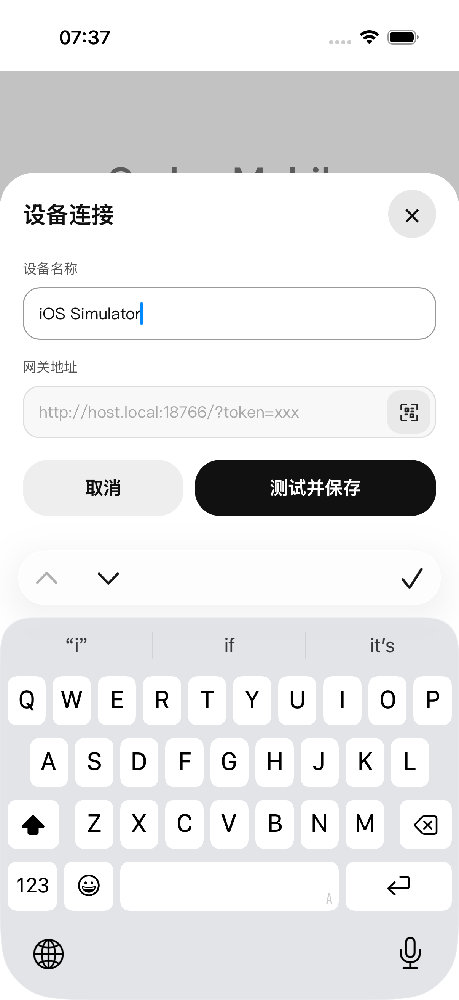
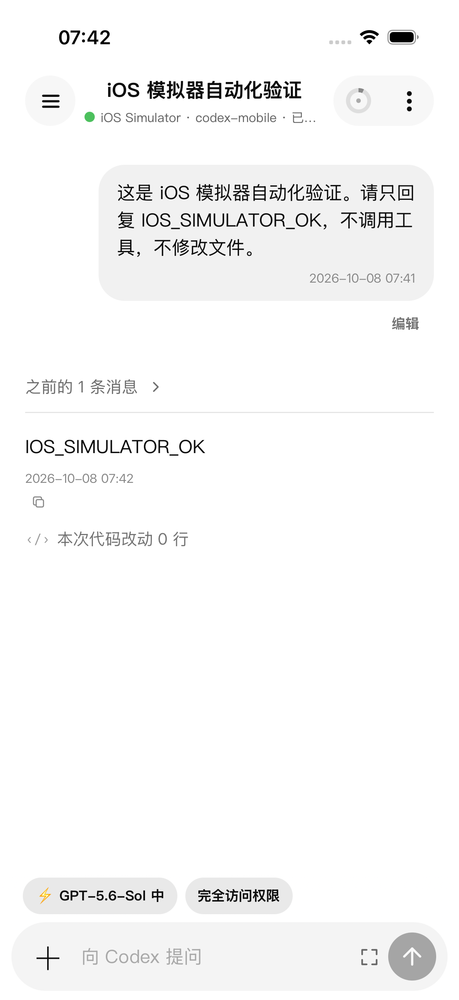

# iOS 本地构建与模拟器验证

本文的带日期章节是对应版本的历史验收记录。固定 `latest` / `current` 链接会随发布更新，表内旧版本大小与散列不能用于校验今天的下载包；当前版本应读取双端固定清单，入口见 [文档索引](README.md)。

Codex Mobile iOS 复用当前 React 前端，内置于固定提交的 PakePlus SwiftUI / WKWebView 容器。设备地址和口令由用户在 App 中添加，构建产物不携带私人网关配置。

当前本机验收设备为iPhone 17 Pro / iOS 27.0；原26.5设备已在保留App数据的情况下原地升级，升级前完整副本仍保留。带日期的旧章节继续保留当时版本与证据。

## 多任务并行验证

允许按任务创建独立的 iPhone 17 Pro 模拟器并行验证，验收范围仍为正常字号、竖屏。同一模拟器同一时间只由一个任务使用，复用同一实例时仍须排队。

- 并行任务按模拟器 UDID 指定目标；下方命令中的名称选择器须替换为 `-destination 'platform=iOS Simulator,id=<本任务模拟器 UDID>'`，避免同型号实例混用。
- 各任务隔离生成工程、DerivedData 和测试结果目录；启动测试网关时使用独立端口与 runtime 文件，避免相互覆盖或干扰。
- 验证完成后及时归档测试会话，关闭本任务启动的测试网关并释放模拟器使用权。

2026-10-19 规则变更：允许多个独立模拟器并行验证，排队范围限定为同一实例；此前带日期记录中的共用模拟器排队描述保留为当时的执行记录。

## 生成与运行

要求 macOS、Xcode、Node.js 20.9+、Git、jq。首次运行先执行 `npm ci`。

```bash
npm run ios:prepare -- --version 0.2.91
open .mobile-build/ios/pakeplus/PakePlus.xcodeproj
```

在 Xcode 中选择 `PakePlus` scheme 和 iPhone 模拟器，再运行。也可通过 XcodeBuildMCP 设置上述工程、scheme 和模拟器后调用 `build_run_sim`。

```bash
xcodebuild \
  -project .mobile-build/ios/pakeplus/PakePlus.xcodeproj \
  -scheme PakePlus \
  -configuration Debug \
  -destination 'platform=iOS Simulator,name=iPhone 17 Pro,OS=27.0' \
  -derivedDataPath .mobile-build/ios-derived-data build
```

`--plan` 只输出步骤。准备脚本复用 `mobile/ios/build-recipe.yml` 中的固定容器提交、pnpm 主版本、前端构建、配置和原生硬化；图标按 asset catalog 的尺寸在本地生成。成功后替换 `.mobile-build/ios/` 中的生成工程；不要在该目录维护手写源码。失败时保留上一次成功工程。

## 模拟器 UI 回归

UI 测试使用真实网关和 Codex app-server，会创建一条仅要求回复标识符的测试会话。使用新的测试模拟器可以完整覆盖首次配置；已配置模拟器会复用现有设备，继续验证重启和消息往返。测试环境需要中文界面。

启动测试网关（确保 `codex` 在 PATH 中）：

```bash
HOST=127.0.0.1 PORT=18786 CODEX_APP_SERVER_PORT=18785 \
CODEX_MOBILE_TOKEN=ios-simulator-check \
CODEX_MOBILE_RUNTIME_FILE=/tmp/codex-mobile-ios-runtime.json \
CODEX_MOBILE_SERVE_STATIC=false npm start
```

这个口令仅用于本机临时测试。测试结束后关闭该终端网关。

安装生成测试 target 的 Ruby 依赖，然后添加测试 scheme：

```bash
gem install xcodeproj --user-install
ruby scripts/configure-ios-tests.rb
xcodebuild \
  -project .mobile-build/ios/pakeplus/PakePlus.xcodeproj \
  -scheme CodexMobileUITests \
  -destination 'platform=iOS Simulator,name=iPhone 17 Pro,OS=27.0' \
  -derivedDataPath .mobile-build/ios-derived-data \
  -parallel-testing-enabled NO \
  -resultBundlePath .mobile-build/ios-ui-tests.xcresult test
```

每次 `resultBundlePath` 应为空目录或使用新名称。XcodeBuildMCP 的 `test_sim` 同样可执行此 scheme。

## 2026-10-08 验证结果

版本 `0.2.91`，原生 build `2091`；iPhone 17 Pro，iOS 26.5，Xcode 27。

| 检查 | 结果 |
| --- | --- |
| 从当前源码生成内置前端和 Xcode 工程 | 通过 |
| 模拟器构建、安装、冷启动 | 通过 |
| 首次设备名称与网关地址输入 | 通过 |
| 错误口令提示与重新配置 | 通过，显示“访问口令不正确” |
| 真实网关初始化与会话列表 | 通过 |
| App 退出重启后设备配置保留 | 通过 |
| 新建会话、打开模型设置、选择“中”推理强度 | 通过 |
| 键盘弹出后输入框和发送按钮可操作 | 通过 |
| 真实消息发送、轮询与最终回复 | 通过，收到 `IOS_SIMULATOR_OK` |
| 未签名真机 Release 构建及 IPA 资源扫描 | 通过 |
| TypeScript 与相关打包、运行环境、viewport 回归 | 通过，21 项 |

XCTest 的完整流程为 1 项集成测试；首次配置验证和最终完整流程分别保留在本机 `.mobile-build/ios-ui-tests-6.xcresult` 与 `.mobile-build/ios-ui-tests-final.xcresult`。





修复了两处原生适配：WebView 只忽略容器安全区，保留键盘避让；Xcode 的 `MARKETING_VERSION` 与 `CURRENT_PROJECT_VERSION` 使用本次发布版本，避免 App 始终显示模板的 `1.0`。

模拟器验证不包含真机摄像头、麦克风、定位及后台推送。未签名 IPA 需要 Apple 签名后才能安装到真机；模拟器使用构建目录中的 `.app`。

## 2026-10-09 未发送草稿与键盘收起回归

新增 `testUnsentDraftRemainsStableAfterKeyboardDismissal`：已配置测试网关后打开新对话，输入草稿，点击系统键盘“Done / 完成”，验证键盘消失、输入框回到底部、12 次位置采样稳定、草稿完整保留，再次输入且发送按钮可操作。该用例不发送消息。

固定 iPhone 17 Pro / iOS 26.5 验证通过。修复在 `keyboardWillHideNotification` 同步取消网页编辑焦点，防止 WKWebView 在键盘收起和视口恢复时继续追踪输入光标。原生临时采样确认失焦后 `scrollY` 和 `visualViewport.offsetTop` 均为 0，DOM 焦点回到 `BODY`。辅助功能的 `Focused` 标记与 DOM 焦点不同，不用作网页焦点的断言。

```bash
xcodebuild -project .mobile-build/ios/pakeplus/PakePlus.xcodeproj \
  -scheme CodexMobileUITests \
  -destination 'platform=iOS Simulator,name=iPhone 17 Pro,OS=26.5' \
  -only-testing:CodexMobileUITests/CodexMobileUITests/testUnsentDraftRemainsStableAfterKeyboardDismissal \
  -parallel-testing-enabled NO test
```

### 点击对号时的动画期补充验证

用户继续复现后，确认前一轮的 DOM 失焦和动画结束后位置采样未覆盖原生图层动画。旧实现的真实绘制帧中，WKWebView 的布局高度与呈现层高度最大相差 `371.94px`，网页已经按恢复后的视口重排，固定输入栏却被仍在插值的原生图层裁剪。

正式容器改用 `CodexMobileWebView`，在 `super.layoutSubviews()` 后移除主图层的 `position`、`bounds` 及其子属性动画。键盘避让和失焦逻辑继续生效，网页子图层动画不受此处理影响。

`configure-ios-tests.rb` 额外安装 `KeyboardLayoutProbeWebView`，用 CADisplayLink 在键盘收起期间逐帧记录高度差。该探针仅出现在显式配置过 UI 测试的工程；普通 `ios:prepare` 和 IPA 发布工程不包含探针。重复配置测试工程已验证幂等。

iPhone 17 Pro / iOS 26.5 的 XCTest 和录屏检查结果：

| 草稿场景 | 动画期最大高度差 | 保留内容、位置稳定及再次编辑 |
| --- | --- | --- |
| 32 字符短文本 | 0px | 通过 |
| 36 字符三行中文 | 0px | 通过 |
| 160 字符长中文草稿 | 0px | 通过 |

三个场景均点击系统键盘对号 `Done / 完成`，并在收起后重复检查输入框位置与草稿，随后重新输入。重新编辑允许光标位于原文中间，移除新增文本后必须完整还原原草稿。单项集成测试通过，保留 `.mobile-build/keyboard-checkmark-verified.xcresult`、`.log` 和 `.mp4`。相关 Vitest 最终运行 52 项及 TypeScript 检查通过。

### 点击发送并收起键盘的补充修复

用户补充点击发送后收起键盘仍偶尔闪烁。旧容器在 `layoutSubviews` 中移除动画，但 UIKit 可以在布局之后继续追加动画；真实点击发送的 CADisplayLink 采样记录到主图层仍有 4 个 position / bounds 动画，新增的零几何动画断言失败。

正式实现改用 `CodexMobileWebViewLayer`，在 `CALayer.add` 入口直接拒绝主图层 position / bounds 动画，其他动画正常交给 `super.add`。网页子图层不使用这个图层类型，因此网页动画保持原有行为。发送表单在调用提交回调、清空草稿或还原最大化状态之前同步取消 textarea 焦点；普通和最大化输入的行为回归先失败、修复后通过。

新增 `testSendingDismissesKeyboardWithoutFlicker`，在 iPhone 17 Pro / iOS 26.5 分别发送短消息、长中文和最大化长中文，只请求回复固定标识。三个场景均验证真实回复、键盘消失、逐帧主图层几何动画数为 0、收起后 12 次位置采样变化不超过 1px，以及下一条输入可编辑；录屏检查通过。相关 Vitest 33 项和 TypeScript 检查通过。

高度探针继续保留为诊断，但不再把原始 model / presentation 高度差单独作为闪烁断言：Core Animation 提交前，新布局和上一呈现帧可以短暂不同。回归使用实际帧采样计数、整个收起期间零几何动画、稳态位置和输入行为作为通过条件。空 textarea 的 WKWebView 辅助功能值可能等于 placeholder；最大化按钮未被暴露为 AXButton 时，测试按相邻输入框定位并验证高度确实展开。

原生结果保留在 `.mobile-build/send-keyboard-verified.xcresult`（发送三场景通过）和 `.mobile-build/send-keyboard-done-verified.xcresult`（对号保留草稿回归）。测试探针仍仅由显式 UI 测试配置安装，不进入正式 IPA。


## 2026-10-10 恢复网页界面

按用户要求移除原生对话、原生边栏、原生 Markdown 和界面切换；网页对话与边栏恢复到原生化之前的实现（`6dc2607` 界面基线）。原有 WKWebView 容器、附件选择、内置浏览器、检查更新、通知深链与键盘修复保留；同期隐藏辅助会话不发送完成通知修复保留。

全量825项Vitest/92个文件、87项iOS Python回归、类型检查和前端构建通过。旧安装偏好和迟到原生事件不能改写网页草稿或搜索的新回归先失败、恢复后通过；运行界面与构建文件逐字核对基线，独立审查通过。

iPhone 17 Pro / iOS26.5成功构建启动；既有 `testBottomBarsClearHomeIndicatorWithoutKeyboard` 和 `testRepeatedKeyboardDismissalPreservesUrlDraft` 两项通过，覆盖原网页边栏/输入、底部安全区、键盘反复收起及草稿保持。本轮未发送测试消息或创建服务器会话。真实截图、日志和结果保存在主工作区 `.mobile-build/ui-rollback-audit/`；模拟器验证不代表真机覆盖安装和数据保留已验证。


回退版本为 `0.2.135`，客户端源码 `20f893e` 已推送main。两端固定清单、HEAD和完整GET校验版本、字节数与SHA-256一致；HTTPS OTA的清单、IPA、manifest和安装页也全部通过。实际IPA中原生对话/边栏类已不存在，签名身份、Team、application-identifier、钥匙串组与entitlements摘要均与0.2.134一致。

[固定OTA安装页](https://192.168.123.79:8766/channels/codex-mobile/current/install.html)

| 产物 | 版本 | 大小（字节） | SHA-256 |
| --- | --- | --- | --- |
| [APK](http://192.168.123.79:8765/channels/codex-mobile/latest.apk) | 0.2.135 | 4,705,315 | `84ef624e34d360d45075a2fdf2fee4100c12b172bb87000648b42266ea1c1c13` |
| [IPA（Ad Hoc已签名）](http://192.168.123.79:8765/channels/codex-mobile/latest.ipa) | 0.2.135 | 3,763,728 | `d2d5602afbc7fc424f650d5f7063797b4de28c56b3ddb9bda08814c52e75d367` |

主工作区生成Xcode工程已同步为网页实现。证据、截图、实际安装包和校验报告保留在 `.mobile-build/ui-rollback-audit/`；本次网关、测试Runner和临时构建缓存已清理，共享模拟器及固定发布锁已释放。未创建或发送测试会话；真机覆盖安装与数据保留仍待验证。


## 2026-10-10 键盘收起同步与审批回复

输入栏改为读取系统键盘约束视图上的弹簧动画参数，并沿同一时间线执行网页关键帧。桥接、resize 和后续视口变化均扣除原生已过时间；原生完整视口与安全区提供稳定终点，终帧保留到 keyboardDidHide，避免附件工具栏分段恢复导致输入栏继续下落。原有失焦、草稿保留与原生图层防闪烁继续生效。

审批界面支持命令、文件及权限确认，按服务器可用决策提交；问题支持选项、其他答案、文字及保密输入。失败保留当前草稿，队列中的相同问题 ID 相互隔离；保密答案不持久化。HTTP 和 WebSocket 在请求解决后清理旧审批，防止重连快照再次展示。

验证包括全量848项Vitest、87项iOS发布脚本测试、类型检查与前端/网关构建；后续键盘时间线14项回归和真实WAAPI探针负例通过。审批完整App的两项HTTP浏览器回归通过，规格与质量审查通过。原生验证与最终发布证据保存在主工作区 `.mobile-build/keyboard-approval-release/`。模拟器结果不代表真机覆盖安装与数据保留已验证。

iPhone 17 Pro / iOS26.5最终四项XCTest通过：反复收起URL草稿、短/多行/长中文草稿、短/长/最大化发送、小字体发送后再次编辑。带拖尾断言的9次收起残差0–0.015625px；草稿和再次编辑检查通过。保留最终录屏、连续帧、日志和两份xcresult；本次12条测试会话已归档。

源码 `7d27d6b` 已推送main，双端固定渠道发布 `0.2.136`。长期网关也已更新到0.2.136，认证健康接口返回appServerReady=true。Android和iOS固定清单、HEAD、完整GET，以及HTTPS OTA清单、IPA、manifest和安装页均核验通过。

[固定OTA安装页](https://192.168.123.79:8766/channels/codex-mobile/current/install.html)

| 产物 | 版本 | 大小（字节） | SHA-256 |
| --- | --- | --- | --- |
| [APK](http://192.168.123.79:8765/channels/codex-mobile/latest.apk) | 0.2.136 | 4,708,339 | `595db3759d649706bb7a221cb90c44a231359859190793aa3657e372db5879f4` |
| [IPA（Ad Hoc已签名）](http://192.168.123.79:8765/channels/codex-mobile/latest.ipa) | 0.2.136 | 3,772,782 | `fa06e45d8bd4fa9e1151b2a8d50561da47fff62adba781de7295dd90865b0174` |

APK证书与0.2.135一致；IPA签名身份、权限摘要与钥匙串组保持连续。最终证据保存在 `.mobile-build/keyboard-approval-release/verification/`，安装包和发布验收记录保存在同目录的 `release/0.2.136/`。已停止专用测试网关，模拟器与发布锁均在收尾释放；临时依赖检出和测试构建清理后归档worktree。


## 2026-10-17 AgentApp 原生迁移（未发布）

源码分支为 `codex/agentapp-native-integration`，本轮运行代码提交为 `a1c9cb2`。原生呈现完整采用 AgentApp 页面与主题，实际状态和操作仍通过现有唯一 WKWebView 与 NativeUIBridge 复用真实业务。无示例设备、模拟执行器或第二套会话持久化。

| 验证 | 结果 |
| --- | --- |
| 全量 Vitest（139 个文件、1520 项，含实际 Swift 执行与跨语言 DTO） | 通过 |
| TypeScript 与内置前端构建 | 通过 |
| iPhone 17 Pro / iOS 26.5、正常字号、竖屏 Debug 构建 | 通过 |
| 6 项 XCTest：原生与侧栏控件、搜索设置、真实设备探测、原生偏好、消息往返及五行用量 | 通过 |
| 测试会话归档、移除测试探针后冷启动原生界面 | 通过 |
| 规格及代码审查发现的身份、附件、项目、审批和未确认回答问题 | 已修复并复验 |

用户提供的网关已在模拟器内完成真实测试保存并选中，访问口令不进入源码、提交或此记录。应用留在已连接设备的新对话页面，等待用户人工验收。旧模拟器中已有设备配置保留。

[结构化证据](superpowers/plans/evidence/2026-10-17-agentapp-native-simulator.json)指向本机保留的 `.mobile-build/agentapp-acceptance/` 日志与结果包。源码 Bundle ID 和 iOS 18 最低版本保持；Debug 版本字段沿用 0.2.190，仅用于本机验收，不代表新渠道交付。本次未合并 main、未生成或发布 APK/IPA、未签名、未修改 OTA/LAN/GitHub Release/软件源，也未部署网关。相机、定位授权及真机覆盖安装不在本次模拟器验证范围。


## 2026-10-18 当前关注会话的分阶段计时

在0.3.6（3006）Debug上显式传入`--conversation-load-profile`，运行`AgentAppUITests/testProfileCurrentPinnedConversationLoading`。测试参数`CODEX_PROFILE_WARM_SAMPLES`和`CODEX_PROFILE_COLD_SAMPLES`分别控制同进程重复与进程重启后的样本数，默认10与3；另自动预热1次。当前环境使用iPhone 17 Pro、iOS26.5竖屏，只读取已存在的关注会话。冷进程的计时从网关已连接后点开会话开始，非App启动性能测试。

本地测量文件位于App Documents中的`conversation-load-profile-*.json`，仅显式开启时生成，保存阶段、数量和散列；不包含正文及连接信息。提取后可运行：

```bash
python3 scripts/analyze-conversation-loading.py <按startedAtMs合并的JSON数组> docs/performance/<本次目录>
```

本轮数据与说明见[测量报告](performance/2026-10-18-conversation-loading/README.md)。最后恢复不带计时参数的正常App；不把Debug模拟器测量作为真机或Release版本性能结论。


## 2026-10-19 升级iOS 27与底部按钮外框回归

使用`simctl upgrade 240244F5-0BEC-4553-A346-32F7D5AD34FC com.apple.CoreSimulator.SimRuntime.iOS-27-0`原地升级现有iPhone 17 Pro；升级前26.5副本`8BE7C3CC-115D-4036-8F5F-93EFCB0B431A`保留。系统语言、App数据与已有网关继续可用；模拟器运行时已实读27.0，不复用其他项目的27.0设备。

`testSidebarControlHeightsMatchChat`在旧实现中首先失败，实测Chat=45pt、搜索/更多=36pt；改为正方形内容后实测三个按钮均45pt，两个圆形按钮均45×45pt，并核对前后截图可见外圈。新对话星星已移除，项目选择与完整路径命令继续通过。四项不同界面检查、26项相关原生契约和typecheck通过；iOS 27菜单项测试按真实可见文案定位，避免旧ID不再暴露造成误判。

结果保留在`/tmp/ios27-sidebar-red-1019.xcresult`、`/tmp/ios27-sidebar-green-1019.xcresult`、`/tmp/ios27-sidebar-interactions-1019.xcresult`和`/tmp/ios27-sidebar-menu-green-1019.xcresult`，前后外圈截图为`/tmp/ios27-sidebar-before-after-1019.png`。本轮未创建业务会话。源码推送main，模拟器保留正常App供用户验收，未发布新包；原有动画对系统减弱动态效果的遵循保持。

用户追加移除侧栏更多菜单的“全部设备”，已先失败后删除，再通过夹具菜单与真实网关搜索/设置两项回归（`/tmp/ios27-sidebar-no-all-green-1019.xcresult`）；具体设备、草稿箱、刷新和设置保留。
