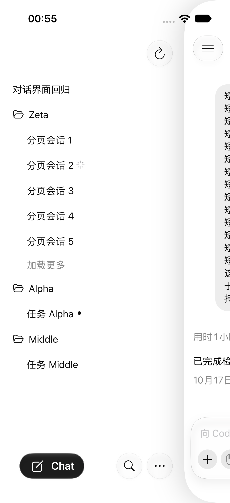

# 2026-10-20 冷启动边栏首批优化：模拟器验收

状态：代码、模拟器交互与耗时分布验证完成；**未发布、未部署网关**。用户最终要求在模拟器修复验证，且运行会话计入每组首批五条。本轮性能结论不代表真机上屏性能。

后续整轮摘要索引、无项目游标及并发选择见[整轮复测报告](../2026-10-20-sidebar-full-refresh-index/README.md)；下文保留本轮历史口径与结果。

## 结果

独立 iPhone 17 Pro / iOS 27.0 模拟器、正常字号、竖屏、HTTP，同一原生 Debug 容器；基线和修复各 20 次进程冷启动。

下表从启动命令发出前开始计时，首批终点是**当前展开项目有数据且 ready 的 JS 原生快照派发**，不是任意折叠项目先返回，也不是原生文字实际显示。

| 指标 | 基线 P50 | 修复 P50 | 基线 P95 | 修复 P95 |
| --- | ---: | ---: | ---: | ---: |
| 启动 → 展开项目首批快照 | 8.85 秒 | **2.65 秒** | 9.42 秒 | **3.07 秒** |
| 启动 → 整轮列表任务结束 | 9.21 秒 | 9.49 秒 | 9.74 秒 | 12.18 秒 |

首批快照中位数在本轮下降约 70%。**整轮刷新没有变快，P95 本轮更高**，不能将首批提前表述为全部刷新提速。最大首批耗时为基线 10.01 秒、修复 3.34 秒；最大整轮耗时为基线 10.31 秒、修复 13.33 秒。

仅从 Web 文档开始计时，展开项目首批快照 P50 为 6549→249 毫秒，P95 为 7128→384 毫秒；这排除了命令、原生容器与 WebKit 文档启动等待，不能把 249 毫秒当成 App 冷启动耗时。Web 文档创建前等待的 P50 为 2.29→2.38 秒。

## 请求证据与剩余工作量

| 本轮观测 | 基线 | 修复 |
| --- | ---: | ---: |
| 当前展开项目请求早于优先摘要发布 | 0/20 次 | **20/20 次** |
| 每轮目录请求中位数 | 2 | **1** |
| 每轮项目 `thread/list` 中位数 | 15 | **13** |
| 每轮轻量 `thread/read` 中位数 | 62 | 62 |
| 无工作目录的全局 `thread/list` | 0 | 0 |
| 分组错误 / 客户端运行异常 / 截尾样本 | 0 / 0 / 0 | 0 / 0 / 0 |

请求记录证实首批不再等待全部优先摘要，目录去重生效，运行会话不再引发额外的普通名额补页。运行摘要仍覆盖完整状态，包括核对已结束运行的旧记录；同轮无项目与优先摘要读取按 ID 复用。约 62 次轻量摘要的工作量尚未减少，因此本轮没有证明整轮提速。无项目仍按已知候选 ID 核对摘要并排序取五条，不是网关直接分页返回五条，也没有读取会话正文或重新扫描全局历史。

只读 HTTP 请求的 POST、操作对账和重试等待共用出队后的剩余预算，避免到期后再额外占用五秒；确定性测试验证预算边界，写请求结果未知时的恢复行为保持。正常网络下这项超时修复不必然减少整轮耗时。

## 最终规则与交互验证

- 每组首批五条计数会话包括运行和空闲会话；运行中的旧未读也计入五条。主动关注独立在顶部，空闲未读沿用独立摘要。窗口外运行元数据可参与汇总，不能额外突破五条展示窗口。
- 首批项目与优先摘要独立推进；展开项目及后续补页使用可见后台优先，仍与其他后台任务共享同源最多两个名额，并让出前台请求。
- 同一连接的目录和列表合并为一轮；旧连接的迟到结果与清理不能覆盖新连接。无项目的更多目标由实际分页数决定，不被窗口外摘要抬高。
- 真正空结果保持首轮完成再收口，已有内容静默刷新与分组错误/重试继续保留。

`AgentAppUITests.testProjectCollapseResetsFiveRowsButDrawerClosePreservesTen` 在独立模拟器正常字号竖屏下通过，最终耗时 42.7 秒：首批五条中第二条运行；更多显示十条；关闭再开侧栏保留十条；显式折叠重开恢复五条。补充文字像素断言，排除控件存在但仍透明的假通过。测试夹具是离线状态，不伪装真实网关成功。

真实 HTTP 冷启动采样与上述离线界面用例分开。业务回归另覆盖普通项目和无项目、运行中的旧未读、关注排除、结束状态回填、五条到十条、快速重复操作及旧连接隔离。

最终 154 文件 **1721 项全量回归通过**，typecheck、前端构建及模拟器 Debug 构建通过。Node 26 下以 `NODE_OPTIONS=--no-experimental-webstorage` 运行测试，避免宿主全局 localStorage 与 jsdom 冲突，没有为此修改客户端运行行为。

## 采样口径

1. 基线前端为 `6f94934`，修复前端为 `674ff41`；完整 SHA、原生可执行文件和 dylib 散列、前端资产及运行文件散列见[环境说明](environment.json)。两组使用本次编译的同一原生容器，因此原生计数交互由独立 UI 用例验证，性能对照反映前端调度与分页变化的合并效果，不能拆分归因到单项优化。
2. 顺序为基线 10、修复 10、修复 10、基线 10。每次终止进程再启动，保留应用数据和系统缓存，不重启模拟器或清理数据；切换构建时覆盖安装。使用同一冻结测试配置：一个真实后端、14 个项目分组含无项目、当前项目展开，其余折叠。不是首次安装或设备重启测试。
3. 原生模式、正常字号、竖屏；首个 ready 快照后通过真实 `navigation.sidebar` 命令路由立即开栏。计时包含启动命令开销，但未测用户触摸输入延迟。
4. 在临时副本注入阶段与计数探针，列表完成 400 毫秒后才向本机回环收集器上传；上传延迟不计入指标。按实际安装包的资源布局制作副本，不注入网络延迟，不改网关返回数据。每次构建切换核对实际安装入口资产散列，每份结果校验构建标签、实际执行的入口标签和文档墙钟，防止将旧文档结果归给新一轮。
5. 起点为宿主机调用 `simctl launch` 前的墙钟；文档以 `performance.timeOrigin + performance.now()` 对齐。首批终点取最初目录快照中唯一展开项目的首次非空 ready 快照派发；整轮终点取加载器 `onSettled`，含后台优先摘要结束。原生解码、布局与动画后的实际文字上屏不包含在分布里。
6. 20 次样本的 P95 使用 nearest-rank，即排序第 `ceil(20×0.95)=19` 项。正式两组均无截尾，不能由此推断真实使用没有长尾。真实后端持续活动，不是固定数据快照；部分样本与同宿主的全量回归重叠，外部 CPU、I/O 与网络负载未隔离。P95 差异不能全部归因于代码，且没有采集 CPU 栈或独立 RTT。

前期旧容器复现、真机旧规则试跑及采样器校准均不混入正式 40 次。最初试采有一次只见探针起点、没有客户端入口事件；旧收集器还缺少版本/文档归属校验，这些数据作废并保留在本机。之后对齐资源布局、增加安装散列、入口标签与文档时间校验，再重新采样。没有将作废数据当作修复成功证据，也没有从正式分布剔除慢样本。模拟器未复现此前真机 66 秒的同类上屏长尾，不能宣称该长尾已经消失。

## 复算与清理

- [samples.csv](samples.csv)：脱敏逐次样本，毫秒；`baseline` 为基线，`fixed` 为修复。
- [summary.json](summary.json)与[analyze.py](analyze.py)：运行 `python3 analyze.py`，仅依赖标准库；缺失的截尾上界按无穷参与排序，JSON 中非有限值写 `null`。
- 原始阶段记录、手机画面、设备信息及测试配置留在本机私有目录，不提交 Git；本目录图片仅含离线测试夹具。
- 结束后停止收集器、释放独立模拟器锁，恢复无计时探针的当前普通构建，无测试参数启动；入口 JS 与最终前端构建逐字节一致。未创建真实测试会话。
- 按用户改为模拟器验收的要求，真机阶段不再作为本轮性能验收；已用固定渠道 SHA-256 核对并 USB 覆盖回原正式 0.3.18，移除临时探针，没有卸载应用，也未把安装返回成功表述为全部数据保留已复验。固定渠道、版本和生产网关均未更改。
