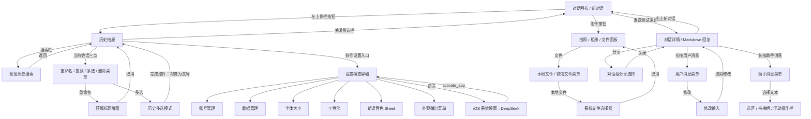
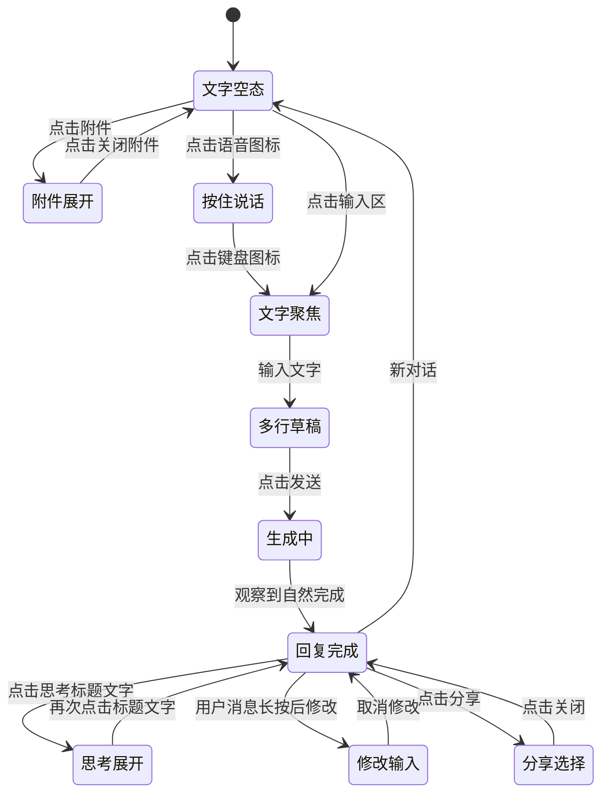

# DeepSeek iOS 真机界面探索记录

本次通过 `ictrl-phone-control` 操作已安装的 DeepSeek，记录页面、导航、截图、可见 UI 层级与交互状态，为 Codex Mobile 后续 iOS 原生界面设计提供参考。这里只描述观察事实与待确认项，未确定新产品架构，也未修改客户端运行代码。

## 证据与环境

- 时间：2026-10-14 00:29–00:40，Asia/Shanghai。
- 应用：`com.deepseek.chat`；安装版本 **2.6.2(2)**，由应用设置页确认。
- 设备：iCTRL 报告为 iPhone，系统 **iOS 27.0**；具体机型未核实。
- 布局坐标：**402 × 874 pt**；截图 **804 × 1748 px**，`scale=2`。面板比例为 3，不能用它换算本次截图坐标。
- 条件：已有登录态、简体中文、竖屏。进入时外观跟随系统，深度思考关闭、智能搜索开启。
- 工具：iCTRL 服务与技能均为 1.96.1，协议 1；使用已有配对的 Python 客户端。
- 共保存 **38 张截图、231 份本机 RPC 记录**。其中 **23 张无个人内容截图**与 **38 份脱敏 AX 层级记录**随本文保留；重复与无变化截图不是独立页面。

阅读入口：[截图与层级目录](inventory.md)、[可浏览证据目录](gallery.html)、[交互记录与验证边界](interactions.md)、[组件与资源清单](resources.md)、[状态元数据及 SHA-256](manifest.json)、[观察到的图像标识](image-identifiers.json)。

私人原图、完整 RPC 与本机浏览目录位于仓库被忽略的 `.mobile-build/deepseek-exploration-2026-10-14/`；完整归档包位于同级 `.mobile-build/deepseek-exploration-2026-10-14-private.zip`。包含历史标题、账号信息、本地文件预览或第三方键盘剪贴板的截图未推送。公开 UI 树以占位文字替换个人信息，保留原框架角色、缩进与坐标。保留截图未修改像素。

截图与 AX 按顺序采集，不是同一时刻的原子快照。AX 是辅助功能层级，不能等同于源码视图树；`Other`、`CollectionView`、类名样式的标识也不能证明整个应用使用某一种框架。

## 页面结构与导航

本次观察到的主入口是对话画布与历史抽屉，没有固定底部主 Tab 导航。设置通过抽屉底部账号入口呈现为模态容器，子设置在容器内返回；语言入口离开 App，进入 iOS 设置。

图中操作菜单列出已看到的选项；置顶、删除、最终分享等结果未执行，不能从选项存在推断已走通。详见下表与未验证清单。

| 页面族 | 组成与状态 | 验证到的导航 / 返回 | 证据 |
| --- | --- | --- | --- |
| 新对话 / 对话详情 | 顶部侧栏按钮、会话标题、朗读与新对话胶囊；滚动画布；底部输入卡片 | 发送、打开侧栏、回到新对话 | S01、S22、S33、S39 |
| 历史抽屉 | 搜索栏、按今天 / 7 天内 / 年月分组的会话、选中行、账号入口 | 展开、关闭、搜索、当前行菜单 | S02、S29 |
| 历史搜索 | 全宽搜索栏、返回、清空控件；聚焦空页与“暂无相关结果” | 查询 `UI-20261014`、返回抽屉 | S13、[S14](screenshots/14-search-no-result.png) |
| 会话管理 | 当前行菜单、重命名弹窗、历史多选；底部置顶 / 删除 | 重命名打开及取消、多选打开及退出 | S30–S32 |
| 设置首页 | 账户、应用、语音、关于；帮助与反馈 | 模态打开、进入子页、叉号关闭 | [S03](screenshots/03-settings.png)、S05 |
| 外观 | 系统 / 深色 / 浅色，当前选项勾选 | 系统 → 深色 → 系统 | S04、S05及恢复动作 |
| 字体大小 | 对话预览、跟随系统开关、带刻度滑块 | 进入与返回；调节未执行 | S06 |
| 语言 | 系统设置的 DeepSeek 权限与首选语言 | App 跳出，随后激活 App 返回 | S07，截图/OCR；AX 不可靠 |
| 个性化 | “思考内容自动折叠”开关及说明 | 进入与返回；开关未修改 | S08 |
| 朗读音色 | 贝壳 / 百变活泼、蓝色动态形状、四个分页点、确认 | 打开；下拉 Sheet 退出 | S09、S10 |
| 数据管理 | 体验优化开关、共享链接、删除所有历史 | 进入与返回；下级与危险操作未执行 | S11 |
| 账号管理 | 邮箱、手机、微信、Google、未成年人模式、登出与注销 | 进入与返回；账号操作未执行 | S12，原图仅本机 |
| 附件面板 | 拍照 / 相册 / 文件三卡 | 展开、收起、文件来源菜单 | S16、S17 |
| 系统文件选择器 | 搜索、视图切换、最近 / 共享 / 浏览 | 从本地文件进入、取消；未选文件 | S18，原图仅本机 |
| 语音输入 | “按住说话”行，右下图标变键盘 | 文字 ↔ 按住说话；未录音 | S19 |
| 消息操作 | 用户四项菜单；助手七项菜单；修改输入提示条 | 长按、进入修改并取消、选择文本 | S25、S26、S36、S37 |
| 分享选择 | 全选、消息勾选、选择组数、四个分享出口 | 打开与关闭；未创建链接或发送 | S27 |

## 关键布局记录

以下数值来自 AX 中的 pt 框。它们是本次设备上的实测框，不是跨设备设计常量；视觉外缘、投影、材质与可点击范围可能不同。

| 区域 | 观察到的框 / 尺寸 | 依据 |
| --- | --- | --- |
| 顶部侧栏控件 | `x16 y62 w44 h44` | S01 |
| 顶部右侧控件组 | `x298 y62 w88 h44`；内部朗读 / 新对话各44pt | S01 |
| 空态内容 | 图标 `x183 y388 w34 h26`；欢迎语 `x48 y431 w306 h23` | S01 |
| 默认输入卡片 | `x12 y736 w378 h104` | S01 |
| 默认输入 TextView | `x22 y740 w358 h43` | S01 |
| 两个模式胶囊 | `x24 / x123 y797 w91 h32` | S01 |
| 附件 / 语音图标 | `33 × 33pt`；展开附件时原加号控件报告约47pt | S01、S16 |
| 附件展开后的输入卡片 | `x12 y586 w378 h104`；下移内容为三张约115×84pt卡片 | S16 |
| 键盘出现后的空输入卡片 | `x12 y369 w378 h104`；截图键盘从约485pt开始 | S20 |
| 多行输入卡片 | `x12 y323 w378 h150`；TextView89pt高，底部发送33pt | S21 |
| 修改输入卡片 | `x12 y275 w378 h198`；提示行、取消修改按钮、原消息、发送 | S26 |
| 历史抽屉 | 宽约321pt，约屏幕宽度80% | S02 |
| 抽屉展开后的主内容 | `x331 y21 w381 h830`，约0.95缩放；右侧仍露出主内容 | S02 |
| 抽屉会话行 | Cell约43pt高，内层`x10 w301 h41` | S29 |
| 设置容器 | `x0 y62 w402 h812`；顶部导航区域约54pt | S03 |
| 设置组与条目 | 组水平边距16pt、宽370pt；条目约50pt高 | S03 |
| 外观菜单 | `250 × 127pt`；每项约35.7pt高 | S04 |
| 朗读音色面板 | 外层`x0 y391 w402 h483`，确认`x32 y782 w338 h48` | S09 |
| 用户消息泡泡 | `x76 y148 w305 h103`；文本内缩16pt横向、10pt纵向 | S22 |
| 助手正文区域 | `x24 y311 w354 h242`；与用户泡泡不同，正文没有整块气泡背景 | S22 |
| 消息动作图标 | 报告`21 × 21pt`；实际触控扩展范围未测量 | S22 |
| 跳到底部 | `x343 y688 w34 h34`；长内容离开底部时出现 | S24、S33 |
| 用户 / 助手长按菜单 | 宽250pt；4项约162pt高 / 7项约269pt高 | S25、S36 |
| 重命名弹窗 | `x41 y178 w320 h190`，按钮各140×48pt | S31 |
| 分享操作区域 | 下方约166pt；生成图片、链接、微信、更多分享四列 | S27 |

圆角、精确字号、行距、阴影、模糊强度、动画曲线尚未测量。截图中顶部与输入卡片有轻描边、柔和投影和材质感；不能据此认定具体 Liquid Glass API 或兼容策略。

## 输入与对话状态

深度思考与智能搜索是独立开关：S20中两者可以同时选中。空输入时右下为语音图标；有文字时变成蓝色发送图标。生成时保留附件与语音并额外出现停止，左侧模式区缩窄。已完成消息出现复制、喜欢、不喜欢、朗读、分享、重新生成动作栏；长回复完成后用“转至底部”返回末尾。

测试消息包含明确的 `UI-20261014` 标记，使用新生成内容，未进入既有历史对话正文。第一条要求二级标题、两项列表和 Swift 代码，观察到渲染与代码块复制入口；第二条要求60条清单，观察到“正在思考”、停止按钮、自然完成与长内容底部。助手输出的检查清单只是测试文本，**不作为 DeepSeek 本身功能的验证证据**。

本次只确认生成中的思考阶段。未捕获正文逐字生成过程；未实际成功停止。停止 ref 在执行前失效，工具返回 `Nothing was tapped`，后续截图已是自然完成。

## 证据可靠性与未验证范围

1. **语言页旧树**：S07 AX仍返回原设置页，截图与OCR则是系统设置。公开层级明确标为不适用，不能按它操作系统页。
2. **键盘误报**：S13、S20、S21、S26、S31截图有第三方键盘，但iCTRL常报告 `keyboard.visible=false`。输入是否成功以实际字段值与截图验收；首次搜索输入未落入，重新定位全宽搜索页字段后第二次成功。
3. **残留节点与遮挡**：退出分享后AX仍出现“已选择1组对话”；回新对话后AX仍残留旧标题，截图不显示。`visible_only`也可能包含被面板遮住的底层节点和跨屏长文本。
4. **按钮中心不总是命中实际视觉标题**：思考标题 Button 的中心第一次无变化；找到其 StaticText ref 后展开成功。朗读音色AX存在`close`，但截图无该控件且点击无变化；下拉手势成功退出。
5. **settle只是画面稳定判定**：会话三点曾报告无可见变化，随后树与截图已显示菜单；不能依据单条成功提示或 `screen_changed=false` 宣称导航结果。

| 未验证项 | 本次到达范围 / 原因 |
| --- | --- |
| 停止生成、停止后续写、重新生成与版本分支切换 | 有按钮；停止请求在执行前失效，其他未触发 |
| 正文流式追加与自动跟随的全部规则 | 捕获思考生成中及自然完成；只验证一次跳到底部 |
| 智能搜索来源卡、引用、网页详情 | 验证模式开关，没有发联网搜索请求 |
| 图片、相机、微信文件、附件上传进度与失败 | 看到入口；只进入本地文件选择器后取消 |
| 语音权限、录音中、取消录音、转写、播放与自动朗读 | 验证按住说话模式和音色Sheet入口；未录音或播放 |
| 搜索命中、高亮、分页、搜索结果定位至正文 | 仅验证空查询和无结果查询 |
| 历史切换、长列表滚动与完整历史分组规则 | 看到可见分组与当前测试行；未遍历用户历史 |
| 置顶 / 取消置顶、批量操作结果、删除确认与恢复 | 菜单和多选模式已记录；未提交 |
| 保存重命名、编辑重发、点赞反馈提交 | 仅打开后取消或看到入口 |
| 分享图片、公开链接、微信与系统分享面板、共享链接管理 | 仅对话组选择页；未创建链接或最终发送 |
| 字体滑块调整、超大字、系统字体变化后的重排 | 进入预览，原跟随系统值未变 |
| 其他音色、切换后的试听与保存 | 只观察贝壳与4个分页点，未横滑/确认 |
| 语言选项和切换后的页面翻译 | 仅进入系统设置落地页 |
| 登录、注册、登录失效、绑定与未成年人模式设置 | 使用已有登录态，未登出或修改账号 |
| 数据授权修改、删历史、登出所有设备与注销 | 只记录入口，不执行 |
| 协议正文、帮助反馈提交、检查更新结果 | 设置首页有入口，未进入 |
| 离线、超时、服务错误、限流、重试、权限拒绝态 | 网络可用条件下探索，未注入异常 |
| iPad、横屏、其他尺寸、旧版iOS、完整深色对话 | 本次一台竖屏iPhone；深色只记录设置及子页 |
| VoiceOver阅读顺序、触控扩展、触觉、动画性能 | AX可读性不是这些项目的真实验收 |
| 字体、图标原文件、材质API、导航技术、真实源码层级 | 只有视觉和辅助功能快照；资源未从IPA提取 |

## 对 Codex Mobile 后续工作的输入

可供设计讨论的参考包括：主内容随抽屉展开移动与缩小、顶部轻量浮动控件、随键盘及附件面板移动的输入卡片、用户泡泡与助手开放正文、分组设置模态、消息菜单和可选择文本。这些均有证据对应。

DeepSeek本次未提供Codex工作流需要的多设备、项目分组、工具调用、文件变更、审批、权限策略和Skill选择参考。未来原生方案应逐项映射本项目能力，不能从DeepSeek页面缺失推断可以省略。

尚待用户决定：原生覆盖哪些页面、是否采用相同抽屉运动、已有Web界面如何迁移、多设备/项目/审批如何放入原生导航、系统版本与材质降级边界。本文没有替这些问题作决定，也没有启动实现。

## 收尾

已退出分享、多选和修改输入，关闭系统文件选择器，恢复外观“系统”、深度思考关闭、智能搜索开启，并回到新对话空态（S39）。保留一条“UI测试回复示例”测试对话，其中两条测试请求；未删用户历史。观察到的会话菜单未提供归档入口，因此不声称DeepSeek测试对话已归档；本次测试证据已在本机归档供复核。

本次仓库变更范围是研究文档、静态证据目录与截图；按仓库规则不触发Web、APK或IPA构建发布。
